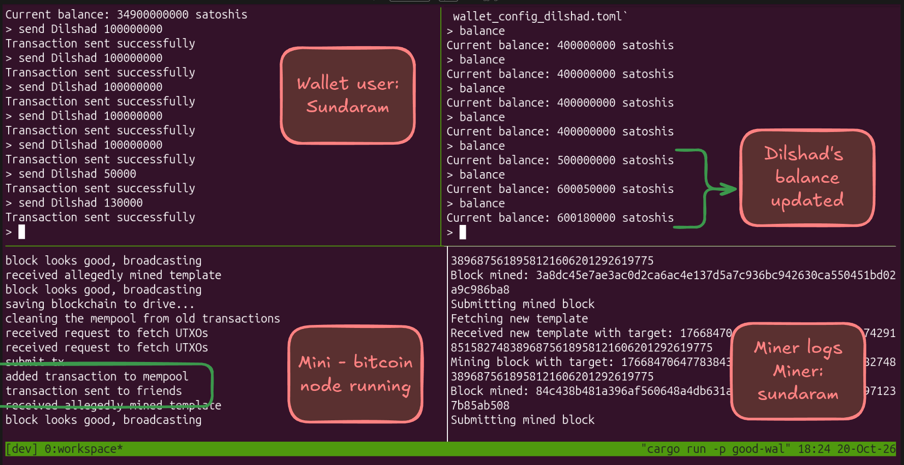
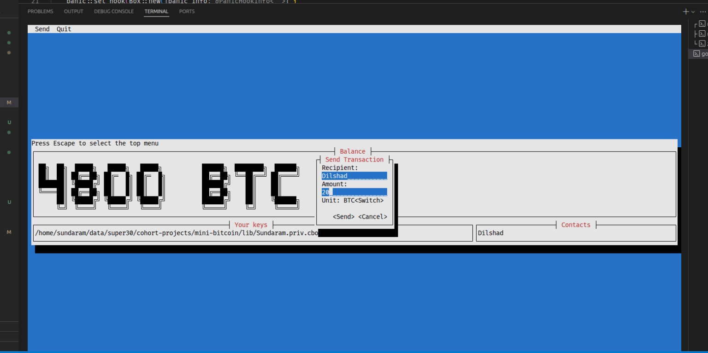
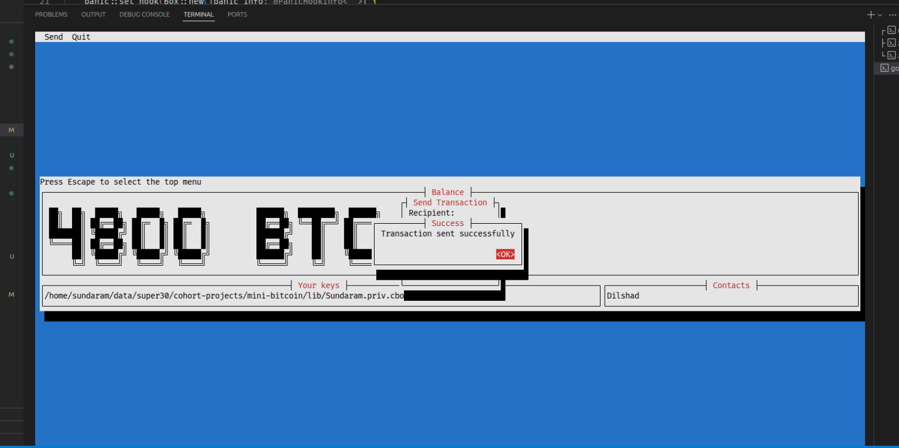
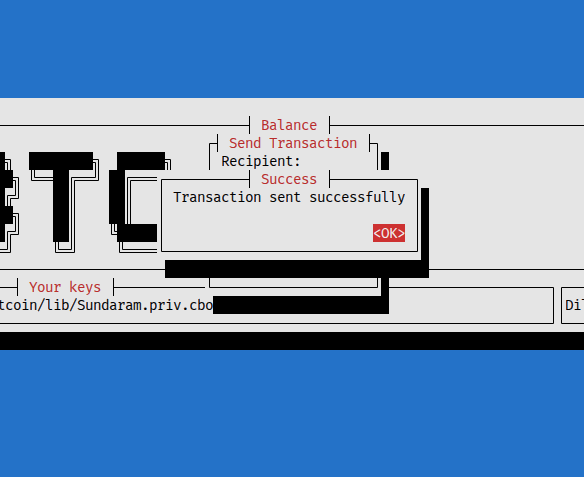

# Mini-Bitcoin 🪙

An educational, lightweight implementation of a Bitcoin-like blockchain network written in **Rust**. It demonstrates fundamental blockchain principles from the ground up:

* **Proof-of-Work (PoW)** consensus with dynamic difficulty retargeting.
* **UTXO (Unspent Transaction Output)** model with ECDSA (secp256k1) signatures.
* **Merkle Trees** for transaction commitment and validation in block headers.
* **Custom Async Binary Network Protocol** framed with CBOR serialization over Tokio TCP sockets.
* **Full P2P Node** managing the mempool, longest chain consensus, and block templates.
* **CPU Miner** solving cryptographic puzzles and claiming block rewards.
* **Wallet**:
  * **CLI Mode** (on branch `main`) for fast, interactive command-line operations.
  * **TUI Mode** (on branch `tui-implementation`) featuring a rich terminal user interface built with Cursive.

---

## Architecture Overview

```
mini-bitcoin/
├── lib/ (btclib)        # Core cryptographic primitives, UTXO blockchain, transactions & networking
├── node/                # Async full node managing mempool, blocks, and peer discovery
├── miner/               # Proof-of-work miner submitting solved block templates
└── good-wallet/         # Interactive wallet supporting key loading, balance queries, and transfers
```

* **`btclib` (`lib/`)**: Provides `Block`, `BlockHeader`, `Transaction`, `TransactionInput`, `TransactionOutput`, and `Blockchain`. Implements secp256k1 key generation, signing, and verification using `k256`, as well as framed TCP binary message handling (`FetchUTXOs`, `SubmitTransaction`, `FetchTemplate`, `SubmitTemplate`, etc.).
* **`node`**: Tokio TCP server (default port `9000`). Syncs the longest chain from peers, builds block templates with coinbase rewards for miners, validates incoming blocks, and manages mempool transactions.
* **`miner`**: Connects to the node, requests a block template paying rewards to the miner's public key, runs nonce search against the 256-bit target difficulty, and submits solved blocks.
* **`good-wallet`**: Tracks UTXO balances, calculates transaction fees, signs inputs, and broadcasts transfers.

---

## 💻 CLI Version Guide (`main` branch)

The `main` branch includes the streamlined interactive command-line wallet.



*The screenshot above demonstrates the end-to-end workflow across 4 terminal panes:*
1. **Top-Left (Wallet)**: Sundaram sending satoshis to Dilshad.
2. **Top-Right (Recipient)**: Dilshad's wallet balance updating in real-time.
3. **Bottom-Left (Node)**: Node validating transactions, adding to mempool, and relaying blocks.
4. **Bottom-Right (Miner)**: CPU miner solving PoW blocks and collecting rewards.

### 1. Build the Workspace
```bash
cargo build --workspace
```

### 2. Generate Keypairs
Use the included `key_gen` tool to generate ECDSA key pairs for the sender and recipient:
```bash
cargo run --bin key_gen Sundaram
cargo run --bin key_gen Dilshad
```
This generates:
* `Sundaram.pub.pem` & `Sundaram.priv.cbor`
* `Dilshad.pub.pem` & `Dilshad.priv.cbor`

### 3. Create Wallet Configurations
Create a config file for Sundaram (`wallet_config.toml`):
```toml
default_node = "127.0.0.1:9000"

[[my_keys]]
public = "Sundaram.pub.pem"
private = "Sundaram.priv.cbor"

[[contacts]]
name = "Dilshad"
key = "Dilshad.pub.pem"

[fee_config]
fee_type = "Percent"
value = 0.1
```

Create a config file for Dilshad (`wallet_config_dilshad.toml`):
```toml
default_node = "127.0.0.1:9000"

[[my_keys]]
public = "Dilshad.pub.pem"
private = "Dilshad.priv.cbor"

[[contacts]]
name = "Sundaram"
key = "Sundaram.pub.pem"

[fee_config]
fee_type = "Percent"
value = 0.1
```

### 4. Start the Node (Terminal 1)
```bash
cargo run -p node -- --port 9000 --blockchain-file ./blockchain.cbor
```
*The node will start as a seed node listening on `0.0.0.0:9000`.*

### 5. Start the Miner (Terminal 2)
Mine blocks and send coinbase rewards (50 BTC = 5,000,000,000 satoshis per block) to Sundaram:
```bash
cargo run -p miner -- --address 127.0.0.1:9000 --public-key-file Sundaram.pub.pem
```
*You will see the miner fetching templates, hashing nonces, and submitting mined blocks to the node.*

### 6. Run Sundaram's CLI Wallet (Terminal 3)
```bash
cargo run -p good-wallet -- --config wallet_config.toml
```
Available interactive commands:
* `balance`: Displays your current confirmed balance in satoshis.
* `send <recipient> <amount>`: Creates, signs, and broadcasts a transaction.
* `exit`: Closes the wallet CLI.

**Example session:**
```text
> balance
Current balance: 5000000000 satoshis

> send Dilshad 100000000
Transaction sent successfully

> balance
Current balance: 4899900000 satoshis
```
*(The node receives the transaction, adds it to the mempool, and the miner includes it in the next block).*

### 7. Verify Dilshad Received the Funds (Terminal 4)
```bash
cargo run -p good-wallet -- --config wallet_config_dilshad.toml
```
```text
> balance
Current balance: 100000000 satoshis
```

---

## 🖥️ TUI Version Guide (`tui-implementation` branch)

If you prefer an interactive Terminal User Interface (TUI), switch to the `tui-implementation` branch.

### Switch to the TUI Branch
```bash
git checkout tui-implementation
```

### Features of the TUI
* **Big ASCII Art Display**: Prominently shows your total confirmed balance in BTC.
* **Top Menu Bar**: Press `Escape` (or click) to open the top navigation menu (`Send`, `Quit`).
* **Visual Send Dialog**: Pop-up modal to select contacts, specify the amount, and send transactions.
* **Real-time Live Polling**: Automatically refreshes UTXO sets and balance in the background.


*Entering recipient and transfer amount inside the modal dialog.*


*Instant transaction broadcast feedback with live ASCII balance.*



### Running the TUI Wallet
Ensure your node is running (`cargo run -p node`), then start the TUI wallet:
```bash
cargo run -p good-wallet -- --config wallet_config.toml
```

**Controls**:
* **`Esc`**: Focus the top menu bar (`Send` / `Quit`).
* **`Tab` / `Shift+Tab`**: Navigate between input fields and buttons (`<Send>`, `<Cancel>`).
* **`Enter`**: Submit dialogs or trigger actions.

---

## Network Protocol Reference

Nodes, miners, and wallets communicate over framed TCP streams using CBOR-encoded messages defined in [`btclib::network::Message`](lib/src/network.rs):

| Message | Direction | Purpose |
| :--- | :--- | :--- |
| `FetchUTXOs(PublicKey)` | Wallet $\to$ Node | Request all UTXOs belonging to a given public key |
| `UTXOs(Vec<(TransactionOutput, bool)>)` | Node $\to$ Wallet | Return the requested UTXOs with mempool lock state |
| `SubmitTransaction(Transaction)` | Wallet $\to$ Node | Submit a newly signed transaction to the mempool |
| `FetchTemplate(PublicKey)` | Miner $\to$ Node | Request an optimal block template with coinbase reward |
| `Template(Block)` | Node $\to$ Miner | Candidate block template with target difficulty |
| `ValidateTemplate(Block)` | Miner $\to$ Node | Check if a template is still valid |
| `SubmitTemplate(Block)` | Miner $\to$ Node | Submit a solved block with proof-of-work |
| `DiscoverNodes` / `NodeList` | Node $\leftrightarrow$ Node | Peer discovery protocol |
| `AskDifference` / `FetchBlock` | Node $\leftrightarrow$ Node | Chain synchronization protocol |

---

## License

MIT / Educational Cohort Project.
